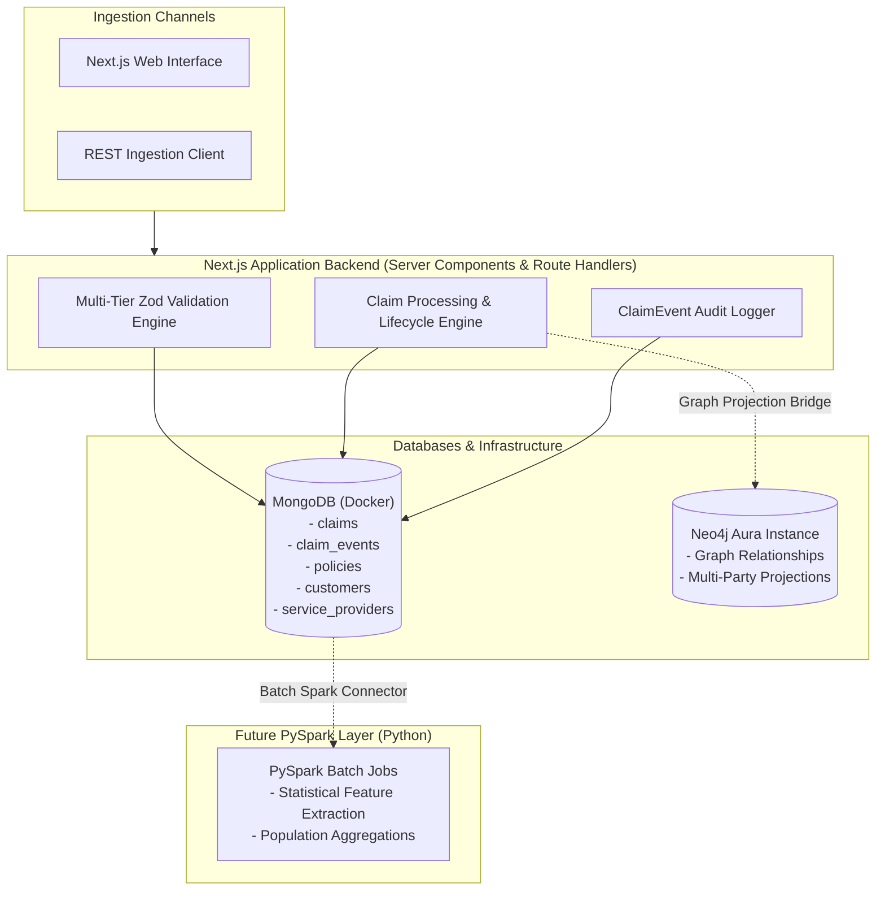

# Big Data Insurance Claims & Multi-Party Fraud Detection
## System Architecture Specification

---

## 1. Executive Vision

This project is a high-throughput **data engineering, graph analytics, and fraud investigation platform** built to process semi-structured insurance claims at scale and expose suspicious multi-party relationship patterns across customers, policies, vehicles, garages, hospitals, and brokers.

### Architectural Tenets
1. **Investigation over Accusation**: The system flags entities and networks as `investigation candidate`, `anomaly`, or `suspicious pattern`. It does not make legal or moral declarations of fraud.
2. **Polyglot Persistence**:
   - **MongoDB**: Primary document store for operational claims, polymorphic details, immutable audit event logs, and master registries (policies, customers, service providers).
   - **Neo4j Aura**: Graph database modeling relationships (`[:OWNS]`, `[:FILED]`, `[:REPAIRED_AT]`, `[:HANDLED_BY]`) for community detection, cyclic patterns, and shortest-path graph analytics.
   - **Apache Spark / PySpark (Future Milestone)**: Distributed batch computing engine for population-scale statistical feature extraction, aggregation, and anomaly scores.
3. **Next.js Server Components as Application Backend**:
   - Next.js App Router Server Components execute on the server, querying MongoDB and Neo4j Aura directly without unnecessary client-side fetch waterfalls or mock data.
   - Route Handlers (`/api/claims`, `/api/health`, `/api/seed`) expose standard REST endpoints for programmatic ingestion.

---

## 2. High-Level System Architecture

---

## 3. Database Responsibilities & Boundary Justification

### MongoDB
- **Semi-Structured Claims**: Claim types (Auto, Health, Property) exhibit vastly different payloads. MongoDB accommodates polymorphic structures without sparse table bloat.
- **Append-Only Event Sourcing**: Lifecycle transitions and validation results are persisted to `claim_events` rather than unbounded arrays inside the claim document, preserving MongoDB's 16MB document limit and preventing storage fragmentation.
- **Source of Truth**: All operational state originates in MongoDB.

### Neo4j Aura
- **Relationship Discovery**: Neo4j does not replicate claim details; it represents the structural topology between entities.
- **Graph Queries**: Used to uncover shared entity networks, dense rings, and multi-hop paths (e.g., 5 claims across 3 customers linked to 1 garage and 1 agent within 30 days).

### PySpark (Phase 4)
- **Large-Scale Aggregations**: Rolling window calculations (e.g., standard deviation of repair estimates for Honda Accords across all garages in Austin, TX).
- **Synthetic Big Data**: Scalable generation and processing of millions of records.

---

## 4. Code Quality & Static Intelligence with Fallow

The project integrates `fallow` for automated static code analysis:
- Zero tolerance for dead files and unused exports.
- Enforced code duplication limits.
- Continuous tracking of Maintainability Index (MI) and cyclomatic complexity.
