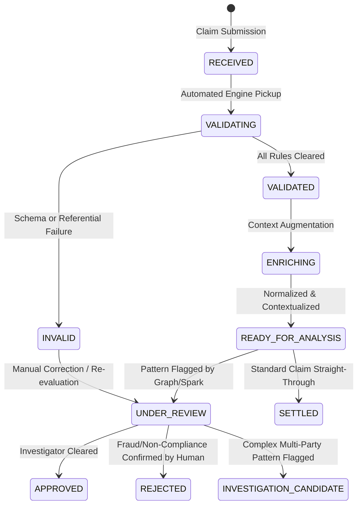

# Claim Lifecycle & Event Audit System

---

## 1. Lifecycle State Machine

Each insurance claim advances through an explicit, auditable state machine. Every state mutation produces an immutable `ClaimEvent` document.



---

## 2. State Definitions

| State | Role in Lifecycle | Next Permitted States |
| :--- | :--- | :--- |
| `RECEIVED` | Payload captured at API ingress, assigned canonical `claim_id` and verified for unique `idempotency_key`. | `VALIDATING` |
| `VALIDATING` | Ingestion pipeline actively executing Tier 1-4 checks. | `VALIDATED`, `INVALID` |
| `INVALID` | One or more structural or policy constraint checks failed. Persisted with explicit error taxonomy. | `UNDER_REVIEW`, `VALIDATING` |
| `VALIDATED` | Passed all structural, temporal, and referential integrity checks. | `ENRICHING` |
| `ENRICHING` | System adds geolocation normalization, provider profiling, and historical metrics. | `READY_FOR_ANALYSIS` |
| `READY_FOR_ANALYSIS` | Canonical claim record published for PySpark batching and Neo4j graph projections. | `UNDER_REVIEW`, `SETTLED`, `INVESTIGATION_CANDIDATE` |
| `UNDER_REVIEW` | Manual adjuster inspection requested due to threshold or anomaly alerts. | `APPROVED`, `REJECTED`, `INVESTIGATION_CANDIDATE` |
| `INVESTIGATION_CANDIDATE` | Graph analytics or big data statistical jobs uncovered a suspicious relationship pattern (e.g., dense provider cluster, cyclic claim ring). | `UNDER_REVIEW`, `REJECTED`, `APPROVED` |
| `APPROVED` | Final positive business determination. | `SETTLED` |
| `REJECTED` | Final negative business determination. | `[*]` |
| `SETTLED` | Payment executed; claim concluded. | `[*]` |

---

## 3. Strict Non-Judgmental Terminology Standards

In accordance with forensic fraud investigation ethics and system design principles:
- **Never** mark a claim, customer, garage, or agent as "fraudulent" or "fraudster" programmatically.
- **Allowed Terms**:
  - `investigation candidate`
  - `risk indicator`
  - `suspicious relationship pattern`
  - `anomaly`
  - `centrality outlier`
  - `dense entity cluster`

---

## 4. ClaimEvent Audit Log Structure

Every transition emits a document into the `claim_events` collection:

```json
{
  "event_id": "EVT-7718290-01",
  "claim_id": "CLM-2026-0920-001",
  "event_type": "LIFECYCLE_TRANSITION",
  "from_status": "VALIDATING",
  "to_status": "VALIDATED",
  "timestamp": "2026-09-20T14:15:02.124Z",
  "trigger_source": "CLAIM_INGESTION_SERVICE",
  "actor": "system_validator_v1",
  "details": {
    "policy_checked": "POL-AUTO-88219",
    "checks_passed": [
      "SYNTACTIC_CHECK",
      "TEMPORAL_SEQUENCE_CHECK",
      "ACTIVE_POLICY_WINDOW_CHECK",
      "INSURED_ASSET_VIN_MATCH",
      "DEDUPLICATION_CHECK"
    ],
    "processing_time_ms": 14.2
  }
}
```
